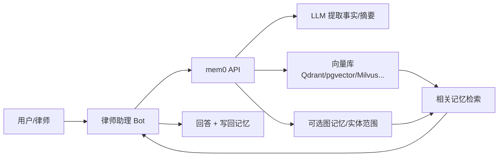
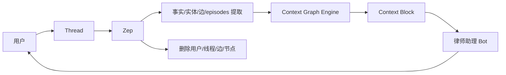
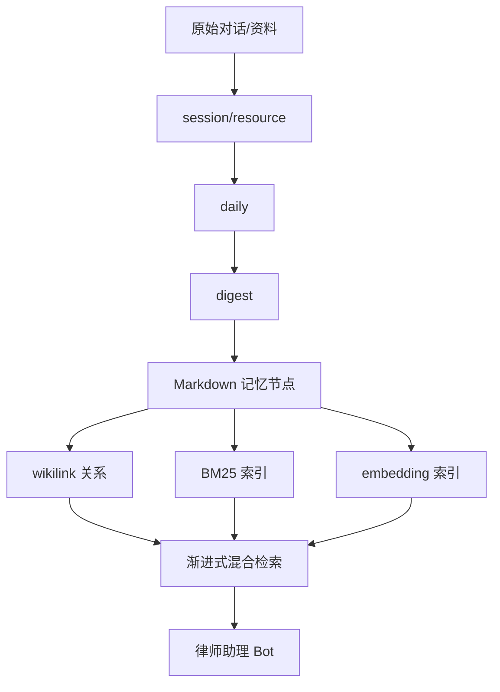
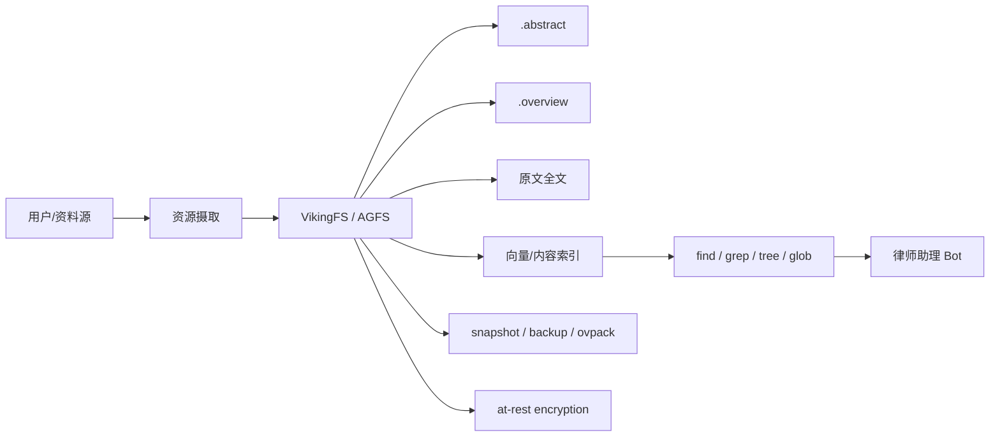

# 律师助理 Bot 的 Agent 记忆组件选型研究

## 执行摘要

面向**律师助理 bot**，我更看重的不是“谁最会做个性化聊天”，而是**谁最适合在高隐私、高精度、高可追溯**的环境里长期稳定运行。基于官方文档、GitHub 仓库、发布记录与论文，我的结论是：

第一梯队里，**Zep、Hindsight、mem0、OpenViking**最值得重点进入选型清单，但它们各自代表不同路线。**Zep**的优势是企业级上下文图谱、低延迟 Context Block、删除用户即级联删除图数据、并明确强调 SOC 2 / HIPAA / BYOC；如果你的目标是“多助手共享案件上下文 + 强治理 + 可扩展”，它是最稳的企业级选择之一。**Hindsight**的优势是 retain / recall / reflect 三段式记忆引擎、四路并行检索、审计日志、Mental Model 与 Memory Defense，更适合“需要可调检索、可观测、可审计”的知识型对话代理。**mem0**的优势是接入快、生态广、向量库/LLM 支持最丰富，适合最短时间做出生产 PoC；但若用于法律场景，建议补强审计、删除、加密与证据级追溯。**OpenViking**则是“文件系统范式”的强代表：上下文分层加载、grep/find/tree/snapshot、可做本地或混合部署，并提供静态加密与备份封装；它对律师场景的**可解释性与操作可审计性**非常有吸引力，但目前仍属较新的 Alpha 水位。 citeturn11search1turn11search8turn11search9turn11search4turn25search0turn25search2turn27search8turn27search10turn8search4turn7search0turn8search1turn21search0turn24search0turn24search15turn24search18

第二梯队里，**ReMe、memU、Letta、MemOS**各有明显长板。**ReMe**和**memU**都偏向“文件化记忆”：可读、可编辑、天然可人工审计，尤其适合律师团队要求“人能直接看见、改动、导出、归档”的管理方式；其中 ReMe 的“Memory as File + wikilink/BM25/embedding 混合检索”更适合法律知识与案件脉络沉淀，memU 的 `INDEX.md / MEMORY.md / SKILL.md` 分层则更适合个人工作台式代理。**Letta**的长板是“状态化 agent”与 MemFS：内存块长期驻留在上下文、归档记忆按需检索、消息自动压缩，做长会话连续性很好；但若放到法律生产环境，仍需额外设计审计、合规删除、证据留痕。**MemOS**更接近“记忆操作系统”，把多模态记忆、工具记忆、知识库、多租户 memory cube、自然语言反馈式修正放进同一框架，纸面能力很强，也有论文与持续发布，但当前生态仍偏新，落地时应先做严格基准测试而不是直接重仓。 citeturn13search10turn13search3turn14search0turn17view0turn17view2turn17view9turn44search9turn38search5turn38search0turn38search1turn38search11turn20view0turn19view8turn19view9turn19view10turn19view12

不建议把**Second Me**和**MetaMem**直接作为律师助理 bot 的底层记忆基座。**Second Me**本质更像“本地化 AI identity / AI self”原型，采用分层记忆建模与个体对齐，适合“个体化数字分身”，不太像企业法务助手的通用记忆基础设施。**MetaMem**则是明显的研究型框架：它建立在 LightMem 等基础之上，用“元记忆”去教模型如何更好利用既有记忆，适合研究和离线实验，但不适合直接作为生产记忆层。 citeturn30view2turn30view3turn30view9turn31search0turn32search0turn33search0turn36view0

如果必须直接给出落地建议：
**企业级正式生产**优先看 **Zep / Hindsight**；
**最快上线 PoC**优先看 **mem0**；
**本地优先、强调人工审阅与证据链**优先看 **OpenViking / ReMe**；
**研究储备与中长期演进**可关注 **MemOS / MetaMem**。 citeturn11search4turn25search0turn8search4turn21search0turn13search10turn20view0turn33search0

## 评估标准与总体判断

针对律师助理 bot，我采用七个核心判断标准：**会话连续性、长期案件记忆、隐私合规、检索精确性、可解释性、审计/回溯、用户控制删除与导出**。其中，法律场景与普通客服场景的关键差异在于，记忆系统不仅要“记得住”，还要能回答**为什么检索出这条信息、它来自哪一次会话或哪份材料、何时被修改、能否彻底删除、是否支持导出与审计**。Zep、Hindsight、OpenViking、ReMe 在这几个维度上更贴近法律落地；mem0 和 Letta 则更偏“好接入、强 agent 体验”；Second Me 与 MetaMem 更偏研究或身份型 AI。 citeturn11search9turn11search2turn25search0turn25search2turn24search15turn24search0turn13search10turn13search3turn38search13

从架构哲学上，这十个对象大致分成四类。**向量/混合检索型**代表是 mem0；**图谱/时序图型**代表是 Zep 与 Graphiti；**文件系统型**代表是 ReMe、memU、OpenViking、Letta MemFS；**研究增强型**代表是 MemOS、Second Me、MetaMem、Hindsight（介于研究与产品之间，但已具工程化形态）。对法律场景而言，最值得注意的是：**文件系统型更利于人工审阅与证据链解释，图谱/混合检索型更利于多跳推理与关系保持，研究增强型多半尚未把治理能力打磨到企业法务要求。** citeturn7search0turn11search1turn12search11turn13search10turn17view9turn21search0turn38search1turn20view0turn27search8turn32search0turn33search0

## 单库概览

下表先给出管理者最需要的“对象视图”。其中“维护状态”是根据**最近发布/更新、release 频率、仓库活跃度**做的工程化判断；若官方未给出明确支持承诺，我标记为“活跃/中等/研究型”而不是“稳定/不稳定”的绝对结论。

| 组件 | 官网 / 仓库 | 最新版本 | 维护状态 | 主要作者 / 公司 | 许可 | 定位简述 | 证据 |
|---|---|---:|---|---|---|---|---|
| mem0 | mem0.ai / `mem0ai/mem0` | Node SDK `v3.0.12`；Python SDK changelog `v2.0.10` | 活跃 | mem0.ai；论文作者含 Prateek Chhikara、Taranjeet Singh、Deshraj Yadav；YC 页面列出联合创始人 Taranjeet 与 Deshraj | Apache-2.0 | 通用 AI memory layer，平台版 + OSS，自带广泛向量库/LLM兼容 | citeturn42view3turn8search1turn42view0turn8search6 |
| Zep | getzep.com / help.getzep.com；官方 SDK 仓库 `getzep/zep-python`、`zep-js`、`zep-go` | JS `v3.22.0`；Go `v3.23.0`；Python Cloud SDK 工作流显示到 `v3.23.0` | 活跃 | Zep 公司；开源 Graphiti 由 getzep 团队维护 | Zep 平台许可未找到；Graphiti 为 Apache-2.0 | 企业级 agent memory / context engineering 平台；开放 SDK，核心思想是 Context Graph / Context Lake | citeturn41search0turn41search1turn41search2turn11search1turn9search6 |
| Letta | letta.com / `letta-ai/letta` | Letta Server `0.16.7`；Letta Code `v0.27.18` | 活跃 | Letta；引用作者含 Charles Packer、Sarah Wooders 等 | Apache-2.0 | Stateful agents；内存块、归档记忆、消息压缩、MemFS | citeturn43search0turn43search5turn39search0turn43search11 |
| ReMe | `reme.agentscope.io` / `agentscope-ai/ReMe` | `v0.4.0.6` | 活跃 | AgentScope / ReMe Team；ACL 2026 Findings 论文作者已公开 | Apache-2.0 | 以 Markdown/Wikilink 为中心的文件化长期记忆工具包 | citeturn15view0turn13search10 |
| memU | `NevaMind-AI/memU` | `v1.5.1`（GitHub 页面镜像结果）；另有 release 页面可见 `v1.5.0` | 活跃 | NevaMind-AI | Apache-2.0 | 个人/工作台型 memory file system，围绕 `INDEX.md/MEMORY.md/SKILL.md` | citeturn44search7turn44search0turn17view0 |
| MemOS | `memos.openmem.net` / `MemTensor/MemOS` | `v2.0.20` | 活跃 | MemTensor；论文作者团队已公开 | Apache-2.0 | “Memory OS”：多模态记忆、多 cube KB、工具记忆、反馈式更新 | citeturn20view0turn19view0 |
| OpenViking | `openviking.ai` / `volcengine/OpenViking` | `v0.4.6` | 活跃但偏 Alpha | ByteDance / Volcengine | 主项目 AGPL-3.0；CLI / examples 为 Apache-2.0 | Agent-native context DB，文件系统范式、分层上下文、快照/备份/加密 | citeturn21search2turn22view0turn24search11 |
| Hindsight | `hindsight.vectorize.io` / `vectorize-io/hindsight` | `v0.8.3` | 活跃 | Vectorize.io / Hindsight Team | MIT | retain / recall / reflect 三段式 agent memory，偏“让 agent 学会思考” | citeturn6search15turn26view0 |
| Second Me | `home.second.me` / `mindverse/Second-Me` | `v1.0.1` | 中等偏活跃 | Mindverse；论文作者 Jiale Wei、Xiang Ying、Tao Gao、Felix Tao、Jingbo Shang | Apache-2.0 | 本地优先的“AI self / AI identity”原型 | citeturn31search0turn30view0turn32search0 |
| MetaMem | `OpenBMB/MetaMem` / 论文页 | 未指定 / 未找到 release | 研究型 | OpenBMB；论文作者 Haidong Xin 等 | Apache-2.0 | 研究型元记忆框架，建立在 LightMem 等之上，用于训练“如何用记忆” | citeturn36view0turn33search0 |

**总体印象**：
如果你在找“今天就能进生产”的基础设施，优先级大致是 **Zep / Hindsight / mem0 / Letta**。如果你在找“更可读、更可审计、更适合律师看得见摸得着”的底层，优先级会变成 **OpenViking / ReMe / memU**。如果你在找“研究领先但尚未证明企业稳定性”的方向，则是 **MemOS / Second Me / MetaMem**。这是对发布频率、功能形态与治理能力的综合判断。 citeturn11search4turn25search0turn8search4turn43search11turn21search0turn13search10turn17view9turn20view0turn31search0turn33search0

## 技术与工程对比

### 关键技术维度横向表

| 组件 | 记忆类型 | 存储后端 | 检索方法 | 压缩 / 摘要 | 更新 / 衰减 | 隐私 / 删除 / 加密 | 扩展性与分布式 | SDK / API |
|---|---|---|---|---|---|---|---|---|
| mem0 | 会话、短期、长期、用户/组织级记忆；平台页还提到图记忆 | Qdrant、Chroma、pgvector、Milvus、Pinecone、Weaviate、FAISS、Redis、OpenSearch 等 | 主要为向量检索；可配图记忆与过滤 | 有自动提取、合并、过期时间、export/import | 支持更新、删除、过期；“移除过时/无关记忆”是官方心智模型的一部分 | 有删除、导出/导入、过期；加密能力主要依赖平台与所选后端，官方未形成统一开源加密层说明 | 由后端向量库与平台版实现横向扩展 | Python / TypeScript / REST / 多集成 | citeturn7search0turn7search2turn8search1turn8search3turn7search17turn7search10 |
| Zep | 线程、事实、实体、边、episode、用户图、总结；时序上下文图 | Zep 托管平台；Graphiti OSS 支持 Neo4j、FalkorDB、Amazon Neptune，并可叠加搜索后端 | 语义检索 + 全文检索 + BFS / 图遍历；Graphiti 为 embeddings + BM25 + 图检索 | summary/basic 两种 context block；自动用户总结 | 通过事实失效、删除线程/边/节点/用户完成更新；支持 bi-temporal 逻辑 | 明确 RTBF；删用户即删线程、消息与知识图；平台宣称 SOC 2、HIPAA、BYOC | 面向“millions of governed Context Graphs”；企业级 Context Lake | Python / TypeScript / Go / REST | citeturn11search8turn11search9turn11search2turn11search4turn12search11turn12search13 |
| Letta | memory blocks（常驻上下文）、archival memory（按需检索）、消息历史 | Letta API 持久层；Docker 模式用 PostgreSQL；MemFS 为 git-backed 本地记忆文件系统 | 归档记忆为语义检索；内存块直接驻留上下文 | 自动 compaction 总结旧消息 | 内存块可读写；消息会被自动压缩，旧消息仍可 API 检索 | MemFS 有版本历史与冲突解决；删除内存文件已有 websocket 命令；统一审计/加密需自行补齐 | 云托管 + 本地后端；可共享 memory block | Python / TypeScript / API / CLI / App | citeturn38search5turn38search0turn38search1turn38search11turn38search6turn38search8 |
| ReMe | 长期文件化记忆；V2 设计还覆盖 identity / personal / procedural / tool / working memory | 核心是 Markdown 文件；不依赖外部 DB 才能成立 | wikilink + BM25 + embedding 的渐进式混合检索 | Auto Memory / Auto Resource / Auto Dream，逐层沉淀 | 支持 add / update / delete；V2 设计含 summary / retrieve / context offload / reload | 天然易审计、易导出；统一加密未指定 | 文件系统天然适合小中规模；多人协作与大并发需额外文件锁/对象存储设计 | Python / CLI / SKILL.md；生态目标含 AgentScope、LangChain | citeturn15view0turn13search3turn13search10turn14search0 |
| memU | profile / event / knowledge / behavior / skill / tool；源文件为 conversation/document/image/audio/video/URL/tool trace | `inmemory`、`sqlite`、`postgres`，并输出 memory tree | 通过浏览 tree + 排序相关文件；嵌入与摘要混合 | folder/topic summary + 结构化 RecallFile/Entry | 支持 patch / re-organize；遗忘机制未见系统化衰减说明 | 本地文件树 + Postgres 可审计；统一加密未见官方说明 | 适合单机/小团队，自行扩展到 Postgres | Python 为主 | citeturn17view5turn17view9turn44search9turn17view0 |
| MemOS | L1 traces、L2 policies、L3 world model、crystallized skills；多模态与工具记忆 | README 显示 Neo4j + Qdrant；调度用 Redis Streams；云/本地均有 | 混合检索；图结构、知识库、记忆反馈 | 有异步摄取 MemScheduler；支持自然语言修正/补充/替换 | 支持 add/retrieve/edit/delete，含精确删除与反馈驱动修正 | 删除 API 明确；统一加密/审计未见完整官方合规页 | Cloud API + self-host；Multi-Cube KB 适合多租户隔离 | API/插件导向；LLM provider 覆盖 OpenAI/Azure/Qwen/DeepSeek/Ollama 等 | citeturn20view0turn19view7turn19view4turn19view8turn19view9turn19view10turn19view12 |
| OpenViking | memory / resources / skills + 会话记忆；L0/L1/L2 分层上下文 | AGFS 文件系统；本地或 S3；向量索引 backend 有 local / Volcengine 形态 | find（语义）、grep（内容）、tree/ls/glob（目录）、分层摘要 | `.abstract` / `.overview` + full content 分层压缩 | reindex、snapshot、session compressor；删除与精细遗忘接口官方说明仍有限 | 提供透明静态加密；支持 local / Vault / Volcengine KMS；支持 `.ovpack` backup | 账号/多租户、S3、本地、队列、watch scheduler，可做混合 | Python/CLI 为主；API 文档清晰，语言级 SDK 未完全成型 | citeturn23search0turn23search1turn22view4turn22view5turn22view6turn24search0turn24search15 |
| Hindsight | World Fact、Experience Fact、Observation、Mental Model；还有 disposition traits / empathy 等“心智参数” | PostgreSQL（默认可嵌入 pg0），可配置只读副本 | semantic + BM25 + graph + temporal 四路并行，之后 RRF + cross-encoder rerank | retain / consolidation / reflect；mental model 汇总 | 以 retain、consolidation、reflect 更新；去重与合并持续增强 | 审计日志、API key、Cloud Connect；Memory Defense 文档存在；删除 bank/document/memory 接口齐全 | 支持副本读库、指标、Cloud / Local / Docker / Bare metal | Python / TypeScript / Go / CLI / HTTP / MCP | citeturn26view4turn26view6turn25search2turn25search0turn27search7turn27search11 |
| Second Me | HMM 分层记忆建模 + Me-alignment；更像“身份 / 个体模型” | 本地部署；模型训练与推理走本地组件 | 论文强调参数化与分层建模，不是通用外部检索框架 | 有训练流程与对齐机制 | 通过训练持续更新“你”的模型；在线删除/审计能力未见完整设计 | 重点强调本地、私密、可控 | 有 Docker 与跨平台部署，但更适合个人而非高并发服务 | 应用型系统，非通用 memory SDK | citeturn30view2turn30view3turn30view6turn30view9turn32search0 |
| MetaMem | factual memory + self-evolving meta-memory | 依赖 LightMem 构造 factual memory；训练脚本与模型服务外置 | 重点不是新的底层检索，而是优化“如何利用记忆” | 通过 self-reflection + symbolic optimization 蒸馏元记忆 | 通过训练迭代更新 meta-memory | 生产治理、删除、加密、审计未指定 | 更适合离线训练与研究复现 | 研究代码；Python 脚本 | citeturn36view0turn33search0 |

### 性能、成本与并发

只有少数组件给出了比较可引用的性能指标。**Zep**官方明确给出 Context Block **P95 < 200ms**；**MemOS**官方宣传异步摄取为“毫秒级”并报告 **35.24% token savings**；**Hindsight**最近版本持续强化 recall/retain 的规模性能，但没有统一对外的固定延迟数字；**mem0、ReMe、memU、Letta、OpenViking**均没有在官方材料中给出可直接对标的公开基准，因此在法律场景里都应按自己的案件规模和文档长度做基准测试，而不是直接相信社区口碑。 citeturn11search0turn20view0turn25search1turn8search5turn13search10turn17view9turn38search1turn23search0

对“未指定”项，我建议用同一套方法估算：
对于 **向量/混合检索型**（mem0、Hindsight、MemOS），先测 `top_k=20`、`100k/1M/10M` 记忆规模下的 P50/P95 检索时延；
对于 **图谱型**（Zep/Graphiti），增加“多跳图扩展深度”与“时间过滤”两个变量；
对于 **文件系统型**（ReMe、memU、OpenViking、Letta MemFS），至少分开测 `grep / semantic find / summary load / full content load`；
并统一记录“每次回答实际带入 prompt 的 token 数”和“检索结果的来源链条是否可回放”。这四个指标比单纯的检索速度更贴近律师助理 bot 的真实成本。相关架构特征均可从各自官方设计中推出。 citeturn11search8turn12search11turn25search2turn38search9turn13search10turn44search9turn23search1turn38search1

就**存储成本**而言，可以做非常实用的工程估算：
如果采用 pgvector / Qdrant 之类的向量后端，成本主要由“记忆条目数 × 向量维度 × 元数据”决定；
如果采用 ReMe / memU / OpenViking 这种文件系统范式，成本主要转为“对象存储 / 本地磁盘 + 少量索引”；
如果采用 Zep/Hindsight 这类托管或平台式方案，除了存储外，还要把**后台提取、总结、重排序、图更新**产生的 LLM 与 worker 成本算进去。
因此，法律场景里常见的经济选择并不是“纯自建最便宜”，而是：**轻量案件记忆适合文件型，本地证据库适合对象存储，跨案件关系记忆才值得上图/向量/重排序。** 这是一种基于官方架构形态的成本推断，而不是厂商报价。 citeturn7search0turn25search0turn13search3turn17view5turn24search15turn11search1

### 律师助理场景适用性评分

| 组件 | 评分 | 结论 |
|---|---:|---|
| Zep | 4.7 / 5 | 最适合企业级法律助手。时序图谱、低延迟 context、RTBF、企业规模治理与 BYOC 很对口，但平台化程度高，自主可控性不如纯文件方案。 citeturn11search1turn11search8turn11search9turn11search4 |
| Hindsight | 4.6 / 5 | 很适合法务研究、问答与持续学习型助手。四路检索、Mental Model、审计日志、Defense 文档是亮点；不足是企业合规叙事没有 Zep 那么成熟。 citeturn25search2turn25search0turn27search10turn27search11 |
| OpenViking | 4.4 / 5 | 对“可解释、可审阅、可备份、可本地控制”的法律场景非常有吸引力。缺点是仍偏 Alpha，且 AGPL 许可会影响商业分发策略。 citeturn21search0turn24search0turn24search15turn24search11 |
| mem0 | 4.2 / 5 | 最快上手、生态最广，适合 PoC 和早期上线。法律场景要补足审计、删除留痕、密钥管理、案件级隔离。 citeturn8search4turn7search0turn8search1turn7search19 |
| ReMe | 4.1 / 5 | 文件即记忆，非常适合法务知识与案件笔记沉淀，人工审查友好；但需要自行做好并发锁、权限、加密与检索评测。 citeturn13search10turn13search3turn14search0 |
| Letta | 4.0 / 5 | 长会话、状态化 agent 很强，适合“长期协作助手”；但原生法律治理能力仍需二次工程。 citeturn38search5turn38search0turn38search11turn38search1 |
| MemOS | 3.9 / 5 | 能力很全，尤其适合多模态与工具调用复杂场景；但对法务团队来说，当前更像“能力储备平台”而非最低风险生产首选。 citeturn20view0turn19view8turn19view9turn19view10 |
| memU | 3.8 / 5 | 个人与小团队工作台很好用，文件树与来源回溯适合律师个体助手；大规模共享、治理、审计能力仍需自建。 citeturn44search9turn17view9turn17view0 |
| Second Me | 2.6 / 5 | 更适合“律师个人数字分身”而不是“企业法务助手底座”。本地私密很好，但不是标准记忆中间层。 citeturn30view2turn30view3turn30view9turn32search0 |
| MetaMem | 1.8 / 5 | 研究价值高，生产适配低。可作为后续离线训练增强层，但不宜直接担任底层记忆服务。 citeturn33search0turn36view0 |

## 代表性架构与数据流

### mem0 代表图

mem0 的强项是把“提取—存储—检索—更新”做成相对薄的一层，能快速挂到现有 bot 上；对律师场景，最适合先做**用户偏好、案件标签、常用模板、术语解释、办案历史摘要**，不建议一开始就把全部原始证据材料塞进记忆层。 citeturn8search4turn7search0turn7search2turn8search1

### Zep 代表图

Zep 的关键不是“存更多文本”，而是把历史交互变成**时序化的用户图谱**。对律师助理来说，这尤其适合“案件参与方—证据—时间线—已给建议—后续待办”的关系型记忆。由于它能把多个线程的相关上下文汇成同一用户图，对跨会话案件追踪非常强。 citeturn11search8turn11search9turn11search2turn11search1

### ReMe 代表图

ReMe 很像“把记忆做成律师也能读懂的知识底稿”。它的真正优势不只是混合检索，而是**记忆本身可直接入卷、导出、人工修订**。如果团队已经习惯 Markdown 知识库、案件日报、证据摘要，这条路线非常自然。 citeturn13search10turn13search3turn14search0

### OpenViking 代表图

OpenViking 的设计特别适合法律工作流，因为律师在很多时候并不想要“黑盒检索结果”，而是想先看到**哪个目录、哪个摘要、哪份原文、哪个快照**。这与文件夹、卷宗、办案材料树的心智模型高度一致。 citeturn23search0turn23search1turn22view4turn22view5turn24search0turn24search15

## 方案建议与实施路线

### 轻量本地方案

**推荐组件**：ReMe 或 memU + SQLite/Postgres + 本地文件系统 + 本地 embedding / 远端 LLM。
**适用对象**：个人律师、精品所、小规模专项项目。
**核心思路**：把会话、文书、检索记录、常用办案流程都沉淀为文件型记忆，优先保证“看得见、能备份、能人工改”。 citeturn13search3turn13search10turn17view0turn44search9

**数据流**：
聊天记录与案件材料进入文件树；
后台生成 topic summary / wikilink / embedding；
bot 先取案件摘要，再按需打开原始条目；
每次生成回答时把“引用了哪些记忆文件”写入审计表。
这一路线的成本通常最低，存储几乎就是文件盘或对象存储成本；主要算力支出来自 embedding 与摘要。 citeturn13search10turn44search9

**优点**：隐私控制强、解释性强、用户可导出。
**缺点**：并发、多租户、复杂权限、跨案件多跳推理要自己补。
**里程碑**：两周完成单律师工作台；四到六周补案件维度索引、删除导出、审计视图。 citeturn13search10turn17view9

### 云向量数据库加 LLM 方案

**推荐组件**：mem0 + Qdrant/pgvector + OpenAI/Anthropic；或 Hindsight Cloud / 自建 Hindsight。
**适用对象**：要在 1 到 2 个月内上线可用版本的团队。
**核心思路**：优先把“常用事实、偏好、案件摘要、待办、模板选择、用户身份画像”结构化进长期记忆，把原始证据材料仍放在单独知识库。 citeturn8search4turn7search0turn25search0

**成本估计**：
向量库成本随案件数与摘要颗粒度线性增长；
主要费用在 LLM 记忆提取与回答阶段；
如果用 Hindsight，可把 recall 与 reflect 分离，通过更便宜模型跑 reflect，并利用其 per-operation 配置控制成本。
这个方案通常是“开发最快 + 体验最均衡”的折中方案。 citeturn25search0turn27search0turn27search2

**优点**：开发速度快、生态成熟、容易接入现有 RAG/Agent。
**缺点**：如果不额外做治理，很容易变成“召回不错但审计薄弱”的系统。
**里程碑**：两周完成存取链路；四周完成案件级 namespace / user deletion / citation logging；六到八周完成回归基准。 citeturn8search1turn25search1

### 混合审计与加密方案

**推荐组件**：Zep 或 OpenViking + 对象存储 / S3 + KMS + 审计日志 + 外部案件知识库。
**适用对象**：中大型律所、企业法务中台、涉敏感行业。
**核心思路**：把“长期案件关系记忆”和“原始材料知识库”分开。前者用图谱或文件上下文系统维持，后者放对象存储与检索层；所有回答必须记录：检索请求、命中的记忆对象、最终引用来源、删除/更正事件。 citeturn11search4turn24search0turn24search15

**为什么适合法律场景**：
Zep 能处理跨线程、跨案件角色与事实关系；
OpenViking 能把材料树、摘要层和快照备份做得非常直观；
两者都比纯向量库更容易构建“给风控/合规/主任律师解释这个 bot 为什么这么答”的机制。
如果你更重企业治理，选 Zep；如果你更重本地可控与文件范式，选 OpenViking。 citeturn11search1turn11search9turn21search0turn24search0turn24search15

**实施步骤**：
先定义案件、客户、当事人、证据、法条、意见、任务这几类核心对象；
再定义删除/更正/冻结/导出事件；
然后为每次回答保存“记忆证据包”；
最后再做模型微调或元记忆优化。
顺序不能反过来，否则很容易先把智能做高，却把合规做成补丁。这个判断与上述系统的官方能力边界是一致的。 citeturn11search2turn11search9turn25search0turn24search15

## 参考资料与局限

本报告优先参考了**官方文档、官方 GitHub、发布页与论文**。优先级建议也保持一致：
第一优先级：官方文档与 SDK API 页；
第二优先级：GitHub README、release、changelog、issue 中的维护信息；
第三优先级：论文与官方 blog；
第四优先级：中文二手资料，仅作背景参考。 citeturn8search4turn11search8turn38search1turn13search10turn25search0turn21search0turn33search0

**开放问题与限制**：
不少项目没有公开统一的**检索延迟、吞吐、并发上限、单位存储成本**数据，尤其是 ReMe、memU、Letta、OpenViking、MetaMem、Second Me；因此这些部分我都明确标记为“未指定”，并给出了基于架构的测试建议，而没有伪造确定数字。对于 Zep、Hindsight、MemOS 的部分性能优势，官方材料可引用，但也仍然应该在你的案件分布、文书长度、权限模型与部署拓扑上做二次验证。 citeturn11search0turn25search1turn20view0turn13search10turn17view9turn38search1turn23search0turn33search0

**最终建议**：
若你现在就要为律师助理 bot 做技术选型，我会按下面顺序推进：

1. **首轮 PoC**：mem0 与 ReMe 双线并跑。一个验证“最快接入”，一个验证“文件化可审计”。 citeturn8search4turn13search10
2. **生产候选**：Zep 与 Hindsight 二选一做深测；若你坚持本地文件范式，再把 OpenViking 加入对照。 citeturn11search4turn25search0turn21search0
3. **中长期演进**：若未来要做多模态、工具记忆、策略学习，再评估 MemOS；若要做离线“如何更好用记忆”的研究增强，再关注 MetaMem。 citeturn20view0turn33search0

在今天这个时间点，我给律师助理 bot 的**默认排序**是：**Zep / Hindsight / OpenViking / mem0 / ReMe / Letta / MemOS / memU / Second Me / MetaMem**。这个排序不是通用 AI 排名，而是站在**法务长期记忆、合规删除、可审计与可解释**的角度给出的工程排序。 citeturn11search1turn25search2turn24search15turn8search1turn13search10turn38search13turn20view0turn44search9turn32search0turn33search0